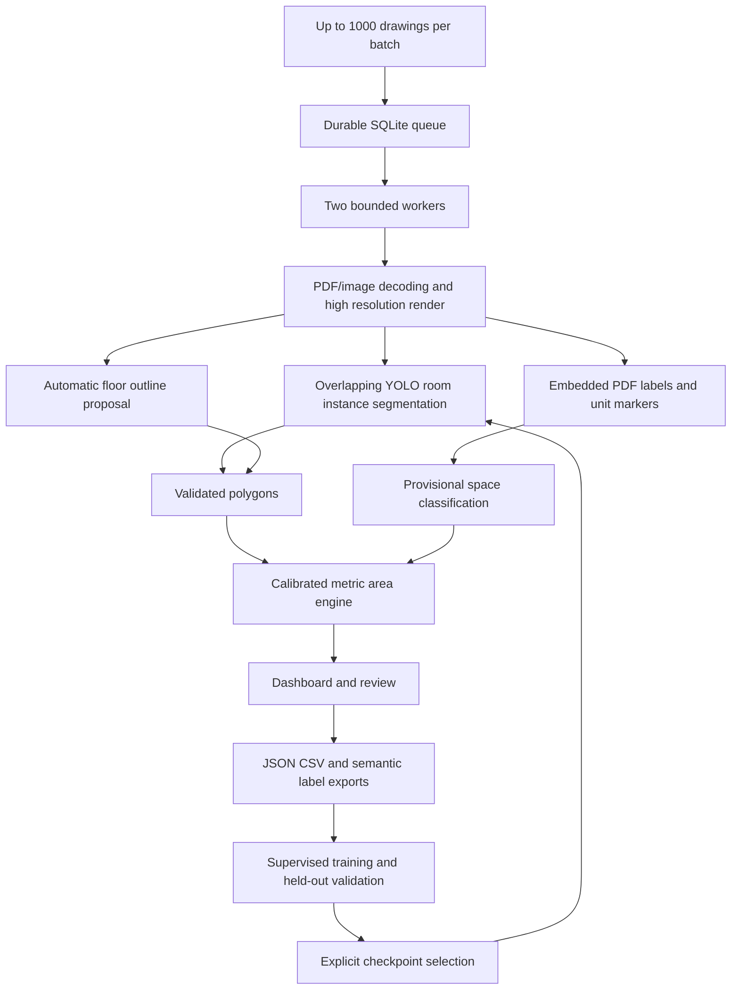

# Architecture

The Flask/Waitress process owns a thread-safe inference cache. YOLO inference is serialized because its predictor is mutable; the queue has two workers so rendering and IO can overlap. This is a single-process reference service. Do not start multiple app processes against the same queue without adding atomic job leasing and a shared worker broker.

Queue state, source uploads awaiting processing and finished JSON/images are on disk. Restart requeues interrupted jobs; a process crash between result creation and queue completion can create a duplicate result on retry. No exactly-once claim is made. Versioned result edits reject stale revisions and write through an atomic replace.

The frontend polls queue state and opens results on demand. It does not load 1000 full plan images into the browser. Queue admission is capped at 1000 pending/processing entries and the last 1000 jobs are listed. CPU throughput depends on page size and tile count; no 1000-page inference benchmark has been performed.

No external API, paid inference service, OCR service or credentials are needed for the current pipeline. GitHub is used to retrieve the pinned pretrained checkpoint; Python package indexes supply dependencies. Deployment as a shared/public service requires authentication, per-user data isolation, worker leasing, retention/storage quotas, monitoring and operational load testing.
